<!--
    Hey there, I'm Matheus Aurélio (MAD-Dcoder)!
    Inspired by daria-stanilevici.
-->

  

### Main skills

### Studying

### Projects

   <strong><a href="https://github.com/MAD-Dcoder/Financas.API">Firmo (Financas.API)</a></strong> — Personal finance full-stack app (C# .NET, EF Core, PostgreSQL/Supabase, React) in production.
  
  <a href="https://github.com/MAD-Dcoder/Financas.API"><picture><source media="(prefers-color-scheme: dark)" srcset="./assets/pill-repo-dark.svg" /></picture></a>

   <strong><a href="https://github.com/MAD-Dcoder/Sentinel-Trace">Sentinel-Trace</a></strong> — Computer Vision pipeline for forensic tracking &amp; Loss Prevention (Python, YOLOv8, ByteTrack, Person Re-ID).
  <a href="https://github.com/MAD-Dcoder/Sentinel-Trace"><picture><source media="(prefers-color-scheme: dark)" srcset="./assets/pill-repo-dark.svg" /></picture></a>

   <strong><a href="https://github.com/MAD-Dcoder/MatchFlix">MatchFlix</a></strong> — Collective movie picker based on preference matching in C#.
  <a href="https://github.com/MAD-Dcoder/MatchFlix"><picture><source media="(prefers-color-scheme: dark)" srcset="./assets/pill-repo-dark.svg" /></picture></a>

### Experience & Education
- **Amazon** *(2026 – Present)* — **Data & Chain of Custody Analyst** (Logistics & Loss Prevention). End-to-end dock & route investigations, dashboards, internal analysis tools, and daily English with global teams.
- **MPK Equipamentos Industriais e Ferroviários** *(2024 – 2026)* — **Electrical Technician & Railway Traffic Operator** (PLC automation, electronic panels, fault diagnostics, CCTV monitoring).
- **Magazine Luiza** *(2019 – 2021)* — **Inventory & Logistics** (stock control, receiving inspection, KPI reporting).
- **PUC Minas** — *ADS (2025 – 2027)* · **CPET** — *Electrical Tech (2025 – 2026)* · **UFV** — *Chemistry / Junior Researcher (2021 – 2024)*.

### Certifications & Community

  
  
  
  

- **Community & Events:** Staff Volunteer at **DevFest BH 2026 (GDG)** · **AWS Student Builder Group (PUC Minas)** · **Google I/O Extended** · **WebTech Days AI Edition** · **Semana Carreira Tec (FIAP)**

### Connect with me!

  <a href="https://financas-api-three.vercel.app"><picture><source media="(prefers-color-scheme: dark)" srcset="./assets/nav-firmo-dark.svg" /></picture></a>
  <a href="https://www.linkedin.com/in/matheus-aur%C3%A9lio-duarte/"><picture><source media="(prefers-color-scheme: dark)" srcset="./assets/nav-linkedin-dark.svg" /></picture></a>
  <a href="mailto:matheussafary@gmail.com"><picture><source media="(prefers-color-scheme: dark)" srcset="./assets/nav-email-dark.svg" /></picture></a>

### Employer?
> [!IMPORTANT]
> Looking for a **Software Developer (C#/.NET, React & Python)** or **Data & Operations-driven Engineer**?
> Connect with me on **[LinkedIn](https://www.linkedin.com/in/matheus-aur%C3%A9lio-duarte/)** or email **matheussafary@gmail.com**!

